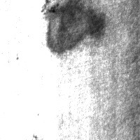
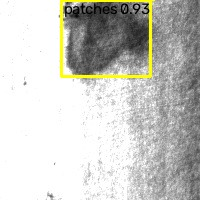
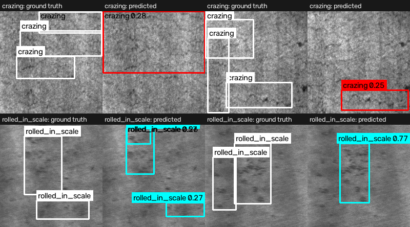

# Industrial Surface Defect Detection (YOLOv8 → ONNX, FastAPI)

[](https://github.com/gunasekhar-7/Industrial-Defect-Detection-YOLOv8-/actions/workflows/ci.yml)
[](https://python.org)
[](https://ultralytics.com)
[](https://onnxruntime.ai)
[](https://fastapi.tiangolo.com)
[](LICENSE)

A 6-class surface-defect detector for hot-rolled steel, trained on the public
**NEU-DET** dataset and served as a hardened **FastAPI** service with an
interactive **Streamlit** inspection dashboard.

Every number on this page comes from a committed artifact —
[`reports/eval_report.json`](reports/eval_report.json) for model quality,
[`reports/benchmark.json`](reports/benchmark.json) and
[`reports/benchmark_spinning.json`](reports/benchmark_spinning.json) for
in-process latency, [`reports/loadtest.json`](reports/loadtest.json) for
service-level throughput under concurrency, and
[`reports/quantization_tradeoff.json`](reports/quantization_tradeoff.json) for
the INT8 decision. Exact, unrounded values are listed under
[Metric provenance](#metric-provenance).

Full documentation — tutorial, how-to guides, API/config/CLI reference and
design notes — lives in [`docs/`](docs/README.md), together with the
[future scope](docs/future-scope.md).

| Input | Output |
|---|---|
|  |  |

---

## Honest results

### Dataset and training

* **Dataset:** [NEU-DET](https://faculty.neu.edu.cn/songkc/en/zdylm/263265/) —
  1800 images of six hot-rolled steel surface defect classes (300 per class).
* **Split:** stratified 70/15/15 into train/val/test
  ([`src/data/neu_det.py`](src/data/neu_det.py)); the evaluation below runs on
  the **270-image validation split** (`"split": "val"`, `"images": 270` in
  [`reports/eval_report.json`](reports/eval_report.json)).
* **Training:** `yolov8n` fine-tuned for **50 epochs** at **imgsz 320**,
  batch 16, on **CPU only** — the executed configuration is recorded in
  `reports/eval_report.json` under `"training"` and was tracked with MLflow
  (local tracking DB, experiment `industrial-defect`).

The model was trained at 320×320 because NEU-DET source images are 200×200;
upscaling to 640 adds no information while quadrupling the pixel count
(640²/320² = 4×) — on CPU-only training that cost is paid every epoch.

### Model quality (validation split, 270 images)

| Metric | Value |
|---|---|
| Precision | 0.6578 |
| Recall | 0.6982 |
| **mAP@50** | **0.7209** |
| mAP@50-95 | 0.4191 |

### Per-class mAP@50-95

| Class | mAP@50-95 |
|---|---|
| crazing | 0.1546 |
| inclusion | 0.3949 |
| patches | 0.6481 |
| pitted_surface | 0.5267 |
| rolled_in_scale | 0.2570 |
| scratches | 0.5334 |

Crazing and rolled-in scale are the hardest classes: their texture is subtle
and they overlap heavily with the other defect types. See
[Limitations](#limitations).



Ground truth (left of each pair, white) against the model's predictions
(right, class colour) on validation frames — the two lowest-scoring classes,
regenerated by [`scripts/make_gallery.py`](scripts/make_gallery.py). Crazing
boxes are merged into one oversized region and rolled-in scale is
over-segmented, which is what a 0.15/0.26 mAP@50-95 looks like in practice.

### Latency and throughput (in-process ONNX Runtime micro-benchmark)

Measured on `models/industrial_yolov8n.onnx`, input `1×3×320×320`,
`CPUExecutionProvider`, 200 runs after 50 warmups:

| Metric | Spinning off (shipped default) | Spinning on (ORT default) |
|---|---|---|
| Median inference | **36.08 ms** | 244.99 ms |
| Mean inference | 32.78 ms | 199.64 ms |
| p95 inference | **45.80 ms** | 296.06 ms |
| p99 inference | 59.16 ms | 334.81 ms |
| Mean end-to-end (pre/infer/post + NMS) | 40.97 ms | 242.00 ms |
| Throughput | **24.4 FPS** | 4.1 FPS |

**Hardware:** `Windows-10-10.0.26300-SP0 | Intel64 Family 6 Model 186
Stepping 2, GenuineIntel | python 3.11.7` — a hybrid (P-core/E-core) Intel
CPU on Windows, no GPU. These are single-image, in-process numbers: they do
not include HTTP overhead.

**Why two columns.** An earlier revision of this page quoted 8.2 ms median.
That value only ever held as a short burst: ONNX Runtime's busy-wait intra-op
thread pool competes with the graph for the same cores on a hybrid CPU, so a
200-run protocol that starts while the CPU is still boosting ends up
anywhere between 12 ms and 300 ms per image. Both runs above use the same
machine, same model, same protocol; only
`session.intra_op.allow_spinning` differs, and it is reproducible with
`--allow-spinning`. [`ONNXDefectDetector`](src/models/benchmark.py) therefore
asks ORT not to spin. The honest headline is ~36 ms median / ~46 ms p95, not
8 ms — a 7× correction in the direction that costs the project, made because
a reviewer re-running the benchmark would otherwise get a different number
than the README.

### Service-level load test (HTTP, concurrent clients)

[`scripts/loadtest.py`](scripts/loadtest.py) POSTs a real 21 KB JPEG to
`/v1/detect` from N concurrent clients. Single `uvicorn` worker, one CPU:

| Clients | Throughput | p50 | p95 | p99 |
|---|---|---|---|---|
| 1 | 14.0 req/s | 69.1 ms | 89.5 ms | 93.2 ms |
| 2 | 20.8 req/s | 91.3 ms | 115.2 ms | 122.4 ms |
| 4 | 26.7 req/s | 135.3 ms | 247.5 ms | 269.9 ms |
| 8 | 25.8 req/s | 297.8 ms | 460.6 ms | 555.7 ms |

All 460 requests returned 200. The worker saturates at roughly **27 req/s**
around 4 concurrent clients; beyond that latency grows and throughput does
not. Horizontal scaling is replicas behind a load balancer (`docker compose`
scales the API service), not a bigger single process.

### INT8 quantization: measured, and not shipped

[`src/models/quantize.py`](src/models/quantize.py) produces a dynamic-INT8
graph and compares it against FP32 on the same 24 validation frames in one
session:

| Model | Size | Median | p95 | Same predicted classes |
|---|---|---|---|---|
| FP32 (shipped) | 12.65 MB | 19.46 ms | 36.91 ms | — |
| INT8 dynamic | 3.36 MB | 291.60 ms | 417.01 ms | 12 / 24 frames |

The FP32 baseline here is lower than in the micro-benchmark table above
because this run uses real 200×200 validation frames over 50 iterations per
model, not the 640-px synthetic frame over 200 — only the FP32/INT8 ratio,
measured back-to-back in one process, is comparable.

INT8 is 3.8× smaller and **15× slower**, and it changes the predicted defect
classes on half the frames. ONNX Runtime's dynamic quantization dequantizes
Conv weights back to FP32 before each convolution, so a convolution-heavy
detector pays the conversion without getting integer kernels. Shipping it
would trade accuracy for nothing, so the API keeps the FP32 graph; a static
QDQ pipeline with a calibration set is the follow-up that could actually
win. The negative result is published rather than quietly dropped.

### Metric provenance (exact, unrounded values)

Verbatim from [`reports/eval_report.json`](reports/eval_report.json):

```json
"mAP50": 0.7208593384148835,
"mAP50_95": 0.4191165798397718,
"precision": 0.6577969755601648,
"recall": 0.6982250905072714,
"per_class": {
  "crazing":         { "mAP50_95": 0.15460208198193207 },
  "inclusion":       { "mAP50_95": 0.39490997930439536 },
  "patches":         { "mAP50_95": 0.6480634660172571 },
  "pitted_surface":  { "mAP50_95": 0.5266763903671192 },
  "rolled_in_scale": { "mAP50_95": 0.2570232558010965 },
  "scratches":       { "mAP50_95": 0.533424305566831 }
}
```

Verbatim from [`reports/benchmark.json`](reports/benchmark.json)
(`allow_spinning: false`):

```json
"mean_inference_ms": 32.77712050017726,
"median_inference_ms": 36.0823499977414,
"p95_inference_ms": 45.79945500154281,
"p99_inference_ms": 59.16023899895661,
"mean_e2e_ms": 40.97464500038768,
"throughput_fps": 24.40533651946316
```

---

## Architecture

```
   [Client / test harness]
            │  multipart image
            ▼
 ┌───────────────────────────────┐
 │  FastAPI service (port 8000)  │
 │  • magic-byte content sniffing│──► 415/400/413 raised before any
 │  • decompression-bomb guards  │    full buffer is allocated
 │  • 15 MB cap (header+stream)  │
 │  • rate limit 60 req/min/IP   │
 │  • explicit CORS origins      │
 ├───────────────────────────────┤
 │  ONNX Runtime session         │──► models/industrial_yolov8n.onnx
 │  letterbox → infer → per-class│    (loaded once, thread-safe)
 │  NMS (IoU 0.45)               │
 └──────────────┬────────────────┘
                │  JSON detections  /  annotated JPEG
                ▼
      GET /health · POST /v1/detect · POST /v1/detect/annotated
      Interactive docs at /docs

 Streamlit dashboard (port 8501) runs its OWN in-process ONNX session
 for local inspection — it does not call the API. That is a deliberate
 trade-off (single-container demos, no cross-service coupling), not a
 shared inference path.
```

---

## Quickstart (tutorial)

Requires Python 3.11.

```bash
git clone https://github.com/gunasekhar-7/Industrial-Defect-Detection-YOLOv8-.git
cd Industrial-Defect-Detection-YOLOv8-

python -m venv .venv
source .venv/bin/activate          # Windows: .venv\Scripts\activate
pip install -r requirements.txt -r requirements-dev.txt
```

**1. Generate the CI dataset and run the tests**

```bash
python -m src.data.generator      # synthetic dataset, no download needed
pytest tests/ -q                   # 122 tests, 100% statement coverage
```

The synthetic generator is what CI uses; it exercises the full
data → label → validation pipeline without network access.

**2. Run the API**

```bash
uvicorn src.api.app:app --host 0.0.0.0 --port 8000
```

* Health: <http://localhost:8000/health>
* Interactive API docs: <http://localhost:8000/docs>

**3. Run the dashboard**

```bash
streamlit run src/ui/dashboard.py  # http://localhost:8501
```

**4. Or run both with Docker**

```bash
docker compose up --build
```

The API container is multi-stage, runs as a non-root user and ships without
`curl`/`libgl` — its `HEALTHCHECK` uses Python's `urllib` against `/health`
(see [`Dockerfile`](Dockerfile)).

---

## How-to: train and evaluate on real NEU-DET data

### Get the dataset (manual-download fallback built in)

The converter fetches the official archive from
<https://faculty.neu.edu.cn/songkc/en/zdylm/263265/> (a Google Drive link)
and caches it:

```bash
python -m src.data.neu_det
```

If that link ever rots — it is a university page — download `NEU-DET.zip`
yourself and point the converter at the local archive or an already-extracted
directory; no network access is needed from that point on:

```bash
python -m src.data.neu_det --archive path/to/NEU-DET.zip
python -m src.data.neu_det --archive path/to/extracted/NEU-DET
```

Both paths are covered by tests
([`tests/test_neu_det.py`](tests/test_neu_det.py)), including the failure
message that tells you where to download the dataset manually.

### Train, evaluate, export, benchmark

```bash
# Train (params/metrics land in the local MLflow tracking DB)
python -m src.models.train --data configs/dataset.yaml --epochs 50 --imgsz 320 --batch 16

# Evaluate -> writes executed config + metrics as JSON
python -m src.models.evaluate \
  --weights runs/detect/industrial_defect_yolov8n/weights/best.pt \
  --data configs/dataset.yaml --split val --imgsz 320 \
  --out reports/eval_report.json

# Export (opset 17, graph-checked) and install as the served model
python -m src.models.export \
  --weights runs/detect/industrial_defect_yolov8n/weights/best.pt --imgsz 320

# Reproduce the latency table (add --allow-spinning for the comparison column)
python -m src.models.benchmark --onnx models/industrial_yolov8n.onnx \
  --warmup 50 --runs 200 --json reports/benchmark.json

# INT8 trade-off and the failure gallery
python -m src.models.quantize --onnx models/industrial_yolov8n.onnx \
  --compare data/processed/images/val
python scripts/make_gallery.py
```

To reproduce the load-test table, start the service with the per-IP rate
limit raised (one load host looks like one abusive client) and run the
harness:

```bash
RATE_LIMIT_DEFAULT=100000/minute uvicorn src.api.app:app --port 8000 &
python scripts/loadtest.py --image data/processed/images/val/crazing_109.jpg \
  --concurrency 8 --requests 240 --json reports/loadtest.json
```

CI never downloads NEU-DET; it always runs against the synthetic generator.

---

## API reference

Interactive OpenAPI docs at **`/docs`** (Swagger UI). Summary:

| Method & path | Purpose |
|---|---|
| `GET /health` | Liveness + model status; returns **503** when the model is not loaded |
| `POST /v1/detect` | JSON detections with a per-stage latency breakdown |
| `POST /v1/detect/annotated` | JPEG with drawn, labelled boxes |

Input guardrails (values from [`src/api/config.py`](src/api/config.py)):

| Guard | Value | Status |
|---|---|---|
| Content types | JPEG / PNG / BMP, verified by magic bytes | 415 |
| Payload cap | 15 MB: `Content-Length` checked before the form is parsed, then enforced while streaming | 413 |
| Image dimensions | 32 … 4096 px, read from the header before allocation | 400 |
| Rate limit | 60 requests/minute per client IP | 429 |
| CORS | explicit origin list, never `*` | — |

---

## Development

```bash
ruff check src tests                 # lint
mypy src                             # types (whole package)
pytest tests/ -q                     # 122 tests, 100% statement coverage
```

CI ([`.github/workflows/ci.yml`](.github/workflows/ci.yml)) runs three jobs on
every branch push and pull request: **lint** (ruff + mypy), **test** (pinned
dev requirements → synthetic dataset → pytest with a 100% coverage floor
and an uploaded coverage artifact) and **docker** (image build smoke gate).

Layout:

```
src/api/       FastAPI app, settings, security boundaries
src/models/    train / evaluate / export / benchmark / quantize (ONNX Runtime engine)
scripts/       load-test harness, GT-vs-prediction gallery renderer
src/data/      synthetic generator, validator, NEU-DET acquisition + conversion
src/vision/    shared detection annotation (one drawing implementation)
src/ui/        Streamlit dashboard
configs/       dataset.yaml (NEU-DET), dataset_synthetic.yaml (CI)
reports/       committed eval + benchmark evidence
```

All dependency versions are pinned exactly in `requirements.txt`,
`requirements-train.txt` and `requirements-dev.txt`.

---

## Limitations

* **Numbers are honest, not impressive.** mAP@50 of 0.7209 comes from 50 CPU
  epochs on a 1800-image dataset; crazing (0.1546) and rolled-in scale
  (0.2570) are weak. Longer or GPU training should improve these — the MLflow
  tracking setup exists to compare such runs.
* **CPU-only measurements.** No GPU was available; latency figures are
  single-image, in-process, from one hybrid x86-64 CPU (the exact hardware
  string is in [`reports/benchmark.json`](reports/benchmark.json)). Absolute
  numbers are hardware-specific — the harness is the portable part, not the
  milliseconds. The single-worker service saturates near 27 req/s on this
  machine.
* **One training seed.** The evaluation is a single 270-image validation run,
  so the per-class scores carry no confidence interval; a 3-seed mean ± std is
  the next measurement worth adding.
* **No authentication or TLS.** The API is meant for a trusted internal
  network; put it behind a gateway before exposing it.
* **The dashboard runs its own model session** instead of calling the API, so
  it can drift from a swapped-in API model if only one side is updated.
* **NEU-DET is not shipped.** Download it (converter or manual) to reproduce
  training; tests and CI use the synthetic generator instead.

## License

[MIT](LICENSE) — see [`LICENSE`](LICENSE).
